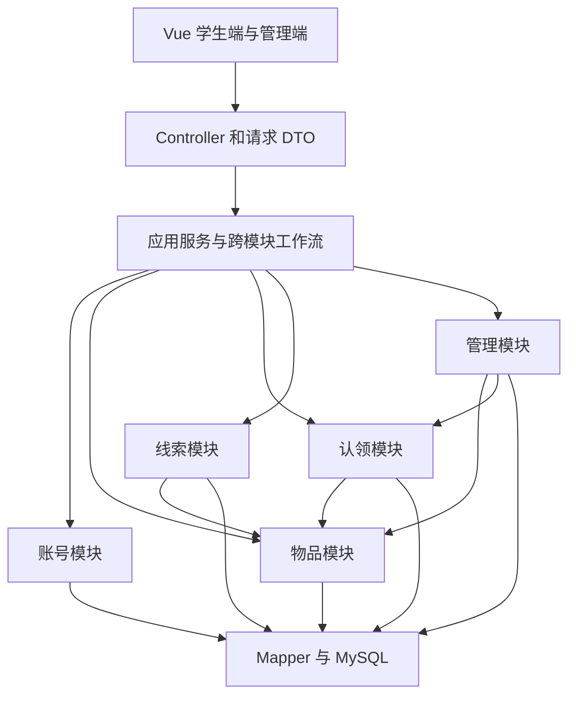

# 校园失物招领系统开发实施手册

版本：1.0 开发准备版。日期：2026-11-04。适用人员：成员甲、成员乙、成员丙。

本文是项目的开发入口，汇总已经讨论的产品范围、环境、分工、架构、接口、数据库、实施步骤、测试和课程交付要求。按第 6～9 章搭建基础框架，再按第 10～13 章开展三人并行开发，第 14～18 章用于联调、验收和课程材料整理。

“已确认”表示用户明确同意的选择；“开发默认”表示为便于执行而沿用当前草案的设计，三人首次评审时应核对；“待核实”表示尚未取得的外部信息。本文不把未来任务写成已完成，也不把 AI 辅助材料标成个人独立初稿。

## 目录

1. 当前起点与文件入口
2. 项目目标、范围和已确认决定
3. 需求清单与验收基准
4. 技术栈及环境配置
5. 三人职责与协作边界
6. 仓库和工程目录
7. 基础框架搭建步骤
8. 后端公共设计与安全实现
9. 前端公共设计与页面规范
10. 成员甲开发说明
11. 成员乙开发说明
12. 成员丙开发说明
13. 跨模块流程与事务
14. 接口和数据库共同约定
15. 开发排期与阶段完成标准
16. 测试、演示和问题排查
17. Git、文档与变更管理
18. 课程作业与个人证据
19. 待核实事项及开发默认
20. 开工检查清单
21. 依据和配套文件
22. 接口总表

## 1 当前起点与文件入口

### 1.1 已完成与未完成

| 内容 | 当前事实 |
| --- | --- |
| 需求讨论 | 已明确三人六组原有功能及简化线索、授权阶段等决定 |
| 技术选型 | 后端 Java 21、Spring Boot、MySQL；前端 Vue 3 技术组合已确定 |
| 本机环境 | 已核对 JDK、Maven、MySQL、IDEA、Node.js、npm 等；现有 JDK 21 可运行 Maven |
| 接口合同 | 51 个接口定义，其中 7 个选做；OpenAPI 静态校验通过 |
| 数据库设计 | 13 张核心表、2 张选做表、建表 SQL、虚拟名册、字段字典 |
| 数据库验证 | 在独立临时 MySQL 8.0.34 中通过 38 项约束/事务/并发 SQL 检查，临时服务已关闭 |
| 业务验收计划 | 已准备 77 个计划用例，当前全部未执行 |
| 后端和前端 | 尚未初始化应用工程，没有已完成的业务代码或页面 |
| 本机项目数据库 | 尚未在原有 MySQL 服务创建项目库、专用账号或可登录演示用户 |
| Git 与 GitHub | 已确定仓库名称；当前尚未初始化本目录 Git 仓库，也未创建或推送远程仓库 |

数据库层检查不等同于后端接口权限或浏览器功能通过；不得把“38 项数据库检查”填成“77 个业务用例已通过”。

### 1.2 文档职责

| 文件 | 作为哪一类信息的依据 |
| --- | --- |
| [技术配置基线](技术配置基线.md) | 环境、版本及已确认配置 |
| [接口决策记录](接口设计讨论稿.md) | 用户已经确认的产品决定 |
| [接口文档](接口文档.md) | BR-01～BR-10 业务和协议规则 |
| [openapi.yaml](openapi.yaml) | 接口路径、请求、响应和字段类型 |
| [接口目录与字段](接口目录与字段.md) | 便于阅读的完整接口及字段说明 |
| [数据库设计](数据库设计.md) | 数据模型、索引、约束和事务理由 |
| [数据库字段字典](数据库字段字典.md) | 实际执行建表后导出的字段定义 |
| [数据库文件说明](../database/README.md) | 迁移顺序和隔离验证方式 |
| [三人开发任务清单](三人开发任务清单.csv) | 可分派任务、依赖、产物、完成标准 |
| [接口需求追溯](接口需求追溯.csv) | 需求与接口的初步映射 |
| [接口验收计划](接口验收计划.csv) | 运行时验收场景 |

本文给出执行路线，不另造一套字段。若实际实现需要改变合同，先记录变更，再同步相关文件；不能仅凭本文摘要修改接口或表结构而不更新 OpenAPI 和迁移。

## 2 项目目标、范围和已确认决定

### 2.1 项目目标与角色

项目名：校园失物招领系统。GitHub 仓库名：`campus-lost-and-found`。形态为电脑和手机浏览器可访问的 Web 应用。

访客可以浏览、筛选、搜索和查看已审核发布的物品；登录学生可以发布信息、管理本人记录、申请认领、提供线索和参与私有沟通；管理员审核信息，选做违规下架及举报处理。

招领场景：拾得者发布 FOUND → 管理员审核 → 失主申请 → 双方留言核实 → 发布人确认认领 → 双方自主授权联系方式 → 线下交接 → 发布人确认完成 → 归档、授权失效。

寻物场景：失主发布 LOST → 管理员审核 → 他人提交文字线索 → 双方私有留言 → 失主标记已找回 → 归档。没有线索也可以标记找回。

### 2.2 已确认决定

| 编号 | 已确认内容 |
| --- | --- |
| D-01 | 线索先做文字提交、私有留言、标记找回；不做线索图片或关联招领信息 |
| D-02 | 联系方式默认隐藏，保留本人向认领对象授权展示的能力 |
| D-03 | 认领申请提交后即可留言，不必等到发布人确认 |
| D-04 | 认领确认后才允许授权联系方式；交接完成后授权失效 |
| T-01 | 本项目用本机 JDK 21，现有全局 JDK 17 可保留 |
| T-02 | 后端采用已记录的 Spring Boot、MyBatis、MySQL 组合，单应用部署 |
| T-03 | 前端采用 Vue 3、TypeScript、Vite、Vue Router、Pinia、Element Plus、Axios、原生 CSS |

开发默认：双方分别授权自己的手机号/邮箱；授权只作用于当前认领中的另一方；撤回立即限制后续查询；资料变化撤回对应字段全部旧授权。线索第一版不开放联系方式授权。

### 2.3 第一版边界

本期不增加自动匹配、图像识别、AI 自动判断归属、实时聊天、语音视频、支付悬赏、短信/微信推送、信用评价、配送、App、小程序或学校统一认证对接。站内留言通过普通 HTTP 请求获取和发送，不承诺实时通知。

FR-21 违规下架、FR-22 举报处理及补充的 FR-27 举报提交为选做。核心流程稳定后再实施；一旦实施举报，就必须同时完成受限会话读取与审计，不能只开放管理员“查看所有留言”。

系统使用虚拟数据演示。AI 在开发与课程评审过程中辅助，不接入系统功能，不代替发布人判断物品归属。原需求单“AI 只整理文字”的描述应如实更新为实际使用范围；原来“已经做进系统”的描述应改为计划或待实现。

## 3 需求清单与验收基准

### 3.1 原有需求与新增需求

| 编号 | 功能 | 原优先级/状态 | 主负责人 |
| --- | --- | --- | --- |
| FR-01 | 学号、姓名、卡号与邮箱验证码注册绑定 | 必做 | 甲 |
| FR-02 | 学号/卡号登录、退出 | 必做 | 甲 |
| FR-03 | 原密码验证后修改密码 | 应做 | 甲 |
| FR-04 | 我的发布、状态与管理入口 | 必做 | 甲 |
| FR-05 | 我提交的认领及进度 | 必做 | 甲 |
| FR-06 | 个人资料与联系方式授权 | 应做；授权阶段已确认 | 甲负责资料，丙负责授权接口 |
| FR-07 | 发布寻物/招领，提交后待审核 | 必做 | 乙 |
| FR-08 | 修改本人信息后重新审核 | 应做 | 乙 |
| FR-09 | 本人下架，保留历史 | 应做 | 乙 |
| FR-10 | 上传 JPG/PNG，每张不超 2MB，最多 3 张 | 应做 | 乙 |
| FR-11 | 已发布列表，时间降序，每页 10 条 | 必做 | 乙 |
| FR-12 | 类型、类别、地点、日期组合筛选 | 必做 | 乙 |
| FR-13 | 标题或描述关键词包含搜索 | 必做 | 乙 |
| FR-14 | 公开详情，仅公开字段 | 必做 | 乙 |
| FR-15 | 提交认领，发布人可见 | 必做 | 丙 |
| FR-16 | 确认唯一认领人 | 必做 | 丙 |
| FR-17 | 有原因地驳回，不能重提 | 应做 | 丙 |
| FR-18 | 发布人确认交接，申请完成、物品归档 | 必做 | 丙 |
| FR-19 | 认领双方留言，举报情境受限查看 | 应做；申请后开放已确认 | 丙 |
| FR-20 | 管理员通过/退回审核 | 必做 | 丙 |
| FR-21 | 违规下架与操作记录 | 可做 | 丙 |
| FR-22 | 举报处理、结论和记录查询 | 可做 | 丙 |
| FR-23 | 提交与查看文字线索 | 新增，编号为开发草案 | 乙 |
| FR-24 | 线索双方私有留言 | 新增，编号为开发草案 | 乙 |
| FR-25 | 我提供/收到的线索记录 | 新增，编号为开发草案 | 甲；单物品查询乙 |
| FR-26 | 寻物发布人标记已找回 | 新增，编号为开发草案 | 乙 |
| FR-27 | 举报提交入口 | 选做新增，补齐 FR-22 | 丙 |
| FR-28 | 我收到的认领申请列表 | 新增，补齐 FR-15 | 甲 |

新增编号及分工以首次团队评审记录为准；不能重排 FR-01～FR-22 使历史追溯失效。每个人负责至少两个功能模块的需求、设计、编码和测试，不采用“一个人只做前端、一个人只做后端、一个人只写报告”的安排。

### 3.2 关键业务验收口径

- 公开列表和详情只返回 PUBLISHED；待审、退回、下架、归档均不可通过猜 ID 查看。
- 发生日期不晚于北京时间当天；描述 10～500 字，标题/地点上限 50。
- 六类物品固定为 DOCUMENT、ELECTRONICS、DAILY、BOOK、CLOTHING、OTHER；增类必须修改需求、前后端和数据库 CHECK。
- FOUND 才能认领，LOST 才能接收线索；发布人不能给自己提交。
- 每用户每物品最多一个认领或一条线索，历史驳回/关闭记录也占用唯一性；补充通过留言完成。
- 开发默认：存在认领/线索历史后不允许再编辑物品内容；无历史编辑后重回待审。
- 开发默认：FOUND 已有 CONFIRMED 申请时禁止本人下架；管理员违规下架属于独立选做流程。
- 确认一个申请时，其他 PENDING 申请变 CLOSED，原因 OTHER_ACCEPTED；不是把其他人都记成“凭证不符”。
- 终态留言可查历史，不再发送；无关用户不得读取同物品的另一条会话。
- 联系方式仅通过专用受控查询返回，公开详情和留言列表不夹带。

### 3.3 非功能需求与测量办法

原需求包含：100 并发用户、1 万条物品时列表/搜索 95% 响应不超 2 秒；发布/认领类提交不超 3 秒；新用户首次发布成功率至少 90%、平均不超 2 分钟；Chrome、Edge 和手机浏览器可用。

开发前把测量口径写入测试计划：硬件、后端/数据库位置、网络、数据分布、并发用户行为与思考时间、预热和测量时长。列表和搜索分别报告 p95、错误率与吞吐，不只统计混合平均值。提交类“3 秒”原文未指定分位数，先按受测请求逐条记录并报告最大值；若改为分位数，必须留下需求变更依据，不能自行降低标准。

易用性测试使用真实未受培训的参与者和统一任务，记录样本数、成功数、每人耗时、失败原因。手机兼容至少记录实际设备/系统/浏览器版本与主要页面结果。任何模板示例中的“500 并发”等数字都不是本项目新增要求。

## 4 技术栈及环境配置

### 4.1 后端和本机工具

| 技术 | 本项目基线 |
| --- | --- |
| JDK | Amazon Corretto 21.0.6；已验证 java、javac、Maven 可运行 |
| Spring Boot | 4.1.2 |
| Web | spring-boot-starter-webmvc，内嵌 Tomcat，可执行 JAR |
| MyBatis Starter | 4.0.0 |
| MySQL | 8.0.34，InnoDB、utf8mb4、utf8mb4_0900_ai_ci |
| 登录 | Spring Security + Session + CSRF |
| 校验 | Spring Boot Validation starter |
| OpenAPI UI | springdoc-openapi 3.2.0 |
| 驱动等依赖 | MySQL Connector/J、Spring Security、Spring Framework 等由 Boot 管理 |
| 构建 | Maven 3.9.4，工程创建后用 Wrapper 固定 |
| IDE | 本机 IntelliJ IDEA 2026.1.1、DataGrip 2026.1.3 |

已有 JDK 21.0.6 和 MySQL 8.0.34 是本地复用版本，不是“最新安全补丁”。本期先保持可复现；计划升级时三人同步验证和记录，不各自切版本。

### 4.2 前端

Vue 3 + TypeScript + Vite + Vue Router + Pinia + Element Plus + Axios + 原生 CSS。Node.js 24.19.0、npm 11.17.0 复用现有环境。采用 Composition API、`<script setup lang="ts">`，一个 Vue 应用内提供学生与管理页面，不建立第二个管理前端工程。

npm 包精确版本尚未锁定。初始化使用稳定 Vue 3 模板，查看实际解析版本，运行类型检查、构建和最小请求验证后，在 package.json 与 package-lock.json 固定。Vue Router、Pinia 的主版本号不需要等于 Vue；以实际 peerDependencies 和构建结果判断，不能拼接不同年代教程里的依赖列表。

### 4.3 当前电脑的路径

```text
工作目录 D:\Users\huangyx\Desktop\Study\软件工程
JDK      D:\Users\huangyx\.jdks\corretto-21.0.6
Maven    D:\maven\apache-maven-3.9.4-bin\apache-maven-3.9.4
MySQL    D:\MySQL\mysql-8.0.34-winx64
```

以上是这台电脑的实际路径，不写死到团队业务代码。其他成员填写自己的路径。IDEA 的 Project SDK、Maven 导入 JDK、Maven Runner JRE 均为 21。全局 JDK 17 保留，本项目终端单独切换。

进入 PowerShell 7：`pwsh.exe -NoLogo -NoProfile`。随后在该终端执行下列环境检查；所有示例是待执行步骤，不是已运行记录：

```powershell
Set-Location -LiteralPath 'D:\Users\huangyx\Desktop\Study\软件工程'
$env:JAVA_HOME = 'D:\Users\huangyx\.jdks\corretto-21.0.6'
$env:Path = "$env:JAVA_HOME\bin;$env:Path"
java -version
javac -version
mvn.cmd -version
node --version
npm.cmd --version
git --version
```

java、javac、Maven 输出都应指向 21。Wrapper 只固定 Maven，不会自动切换 JDK。运行 .ps1 使用 `pwsh.exe -NoLogo -NoProfile -File`；不使用旧 Windows PowerShell。

## 5 三人职责与协作边界

### 5.1 每个人交付完整功能

| 人员 | 两组原有功能 | 新增协作范围 | 前端 | 后端 | 必交测试和材料 |
| --- | --- | --- | --- | --- | --- |
| 甲 | 注册登录；个人中心与我的记录 | 线索/认领聚合列表，资料变化撤回授权的协调 | 登录注册、个人资料、四类记录入口 | account、personal、资料工作流、公共认证 | 注册/登录/越权/资料联动测试；个人需求与架构、RTM |
| 乙 | 发布；查找 | 简化线索完整流程 | 公共列表、详情、发布编辑、图片、线索详情和留言 | item、clue、存储与图片访问协调 | 可见性、字段/文件边界、搜索、线索与归档测试；个人材料 |
| 丙 | 认领；管理 | 联系方式授权，选做举报 | 认领处理、授权面板、审核/举报后台 | claim、moderation、审核与审计 | 状态/并发/授权/管理权限测试；个人材料 |

甲的“我的记录”必须实现有权限的查询、分页、状态展示和导航，不是只有几个链接。乙增加线索后工作量增多，丙的举报保持选做；若调整工作量，先记录边界再修改任务清单，不用共同署名掩盖实际分工。

### 5.2 公共基础能力主责

| 基础能力 | 主责 | 复核人 | 可验收产物 |
| --- | --- | --- | --- |
| 后端工程、响应/异常、requestId | 甲 | 丙 | 可启动、统一 JSON 成功和失败 |
| Security、Session、CSRF | 甲 | 丙 | 匿名令牌、登录、受保护接口、退出 |
| 前端工程、布局、组件和 Axios | 乙 | 甲 | 前端构建、代理、登录态初始化、统一错误 |
| 数据库迁移核对与共享 SQL 规则 | 丙 | 乙 | 三人可独立初始化本地库，约束一致 |
| 文件存储和图片权限入口 | 乙 | 丙 | 上传/绑定/读取均可测 |
| 状态字典与审计写入能力 | 丙 | 甲 | 前后端枚举一致，事务内日志可查 |
| 联调与验收记录汇总 | 丙组织，三人各执行本人用例 | 三人互查 | 真实执行结果、缺陷、回归证据 |

### 5.3 内部调用约定

- 甲展示我的发布，编辑/下架调用乙的公开 HTTP 接口，不再写一份物品更新逻辑。
- 甲展示收到的申请，确认/驳回/交接调用丙的接口。
- 丙审核或完成交接时，通过乙负责的物品领域服务更新状态，仍处于同一应用和同一数据库事务，不通过本机 HTTP 回调自己。
- 乙维护线索留言，丙维护认领留言；前端复用展示组件，后端分别校验参与关系。
- 联系方式资料属于甲，按认领授权属于丙。由上层 ProfileWorkflowService 协调“改资料 + 撤授权”，避免 account 与 claim 互相依赖。
- 图片私有访问可能依赖物品、认领和线索关系。由上层 ImageAccessService 协调读取权限，item 本身不反向依赖 claim/clue。

## 6 仓库和工程目录

当前工作目录作为未来仓库根目录使用，GitHub 仓库名可以是 campus-lost-and-found，不要求本地文件夹改名。保留现有 docs 与 database，不重新生成覆盖它们。

```text
软件工程/
├─ backend/
│  ├─ pom.xml
│  ├─ mvnw.cmd / mvnw / .mvn/
│  └─ src/
│     ├─ main/java/com/campus/lostfound/
│     │  ├─ CampusLostFoundApplication.java
│     │  ├─ common/          响应、异常、分页、请求追踪
│     │  ├─ config/          Security、MyBatis、自定义配置绑定
│     │  ├─ infrastructure/  邮件、文件、Clock 等适配
│     │  ├─ application/     跨模块资料工作流、图片访问协调
│     │  └─ modules/
│     │     ├─ account/      注册、登录、身份、验证码
│     │     ├─ personal/     本人资料及各类记录入口
│     │     ├─ item/         物品、图片绑定、公开查询
│     │     ├─ clue/         线索和线索留言
│     │     ├─ claim/        认领、认领留言、授权
│     │     └─ moderation/   审核、违规处置、选做举报
│     ├─ main/resources/
│     │  ├─ application.yml
│     │  ├─ application-dev.yml
│     │  └─ mapper/          按模块存放 XML SQL
│     └─ test/               与业务模块对应的测试
├─ frontend/
│  ├─ package.json / package-lock.json / vite.config.ts
│  └─ src/
│     ├─ api/                http.ts 与模块请求封装
│     ├─ types/              接口 DTO 与状态类型
│     ├─ stores/             当前用户等共享状态
│     ├─ router/
│     ├─ layouts/            学生端与管理端布局
│     ├─ components/         公共表单、状态标签、留言、授权面板
│     ├─ views/              按 account/personal/item/clue/claim/admin 分组
│     └─ styles/
├─ database/                 已有迁移、名册、隔离验证工具
├─ docs/                     已有合同、设计、本手册、个人证据索引
├─ runtime/                  本机上传/开发收件箱，忽略提交
├─ .gitignore
└─ README.md
```

每个后端模块按需要设 controller、dto、service、mapper、entity。不要为了层数机械生成每个类的接口和 Impl；只有身份验证适配、邮件发送、存储等明确易变点优先抽象接口。



这是最终实施结构的说明，不是架构专项阶段 1 的独立上下文材料；专项的比较和自主裁决仍需真实完成。

## 7 基础框架搭建步骤

### 7.1 第一步：三人完成环境复现

甲检查 JDK/Maven，乙检查 Node/npm，丙检查 MySQL；然后每个人都实际在自己的电脑验证完整环境。保存版本输出到本人工作记录，修正 IDEA 使用的 JDK，不以“IDEA 能打开”代替命令行构建成功。

本机 MySQL 服务已运行，但账号和建库权限尚未验证。数据库凭据通过本机安全配置提供，不要求把密码发到聊天或提交 Git。先只检查项目库是否存在；不存在时创建，有同名旧库时核对归属，不能覆盖。

### 7.2 第二步：初始化本地数据库

使用迁移账号进入 MySQL 客户端，先确认 `SELECT VERSION()` 与当前目标库。工作目录位于仓库根目录时，在 mysql 客户端执行：

```sql
SOURCE database/000_create_database.sql;
USE campus_lost_found;
SOURCE database/migrations/V001__core_schema.sql;
SOURCE database/seeds/S001__mock_students.sql;
-- 选择实现举报模块后再执行：
-- SOURCE database/migrations/V002__optional_reports.sql;
```

源码实际路径见 [数据库说明](../database/README.md)。不要把 MySQL 的 SOURCE 当成 PowerShell 命令，也不要在 PowerShell 使用传统 shell 的 `< 文件` 重定向语法。迁移失败即停止，DDL 不保证整份事务回滚。重复执行不要加 --force 或关闭外键检查。

创建项目专用应用账号；应用不使用 root，迁移权限与运行权限分开。不要导入 database/tests/fixtures.sql 作为演示账号，那里的密码字段是不可登录的验证占位内容。

### 7.3 第三步：建立 backend

在 IDEA 的 Spring Initializr 或官方 Initializr 创建 Maven / Java / JAR 工程，项目放在 backend。Group 设 `com.campus`，Artifact 设 `lost-found-backend`，Package 设 `com.campus.lostfound`，Java 21，Boot 4.1.2。若界面不显示该补丁版本，在生成后按已确定基线调整 parent，再解析依赖验证，不默默换主版本。

基础 pom 内容如下，可用于核对生成结果；它只是工程配置，不含业务实现：

```xml
<project xmlns="http://maven.apache.org/POM/4.0.0"
         xmlns:xsi="http://www.w3.org/2001/XMLSchema-instance"
         xsi:schemaLocation="http://maven.apache.org/POM/4.0.0 https://maven.apache.org/xsd/maven-4.0.0.xsd">
  <modelVersion>4.0.0</modelVersion>
  <parent>
    <groupId>org.springframework.boot</groupId>
    <artifactId>spring-boot-starter-parent</artifactId>
    <version>4.1.2</version>
    <relativePath/>
  </parent>
  <groupId>com.campus</groupId>
  <artifactId>lost-found-backend</artifactId>
  <version>0.1.0-SNAPSHOT</version>
  <properties>
    <java.version>21</java.version>
    <project.build.sourceEncoding>UTF-8</project.build.sourceEncoding>
  </properties>
  <dependencies>
    <dependency>
      <groupId>org.springframework.boot</groupId>
      <artifactId>spring-boot-starter-webmvc</artifactId>
    </dependency>
    <dependency>
      <groupId>org.springframework.boot</groupId>
      <artifactId>spring-boot-starter-security</artifactId>
    </dependency>
    <dependency>
      <groupId>org.springframework.boot</groupId>
      <artifactId>spring-boot-starter-validation</artifactId>
    </dependency>
    <dependency>
      <groupId>org.mybatis.spring.boot</groupId>
      <artifactId>mybatis-spring-boot-starter</artifactId>
      <version>4.0.0</version>
    </dependency>
    <dependency>
      <groupId>com.mysql</groupId>
      <artifactId>mysql-connector-j</artifactId>
      <scope>runtime</scope>
    </dependency>
    <dependency>
      <groupId>org.springdoc</groupId>
      <artifactId>springdoc-openapi-starter-webmvc-ui</artifactId>
      <version>3.2.0</version>
    </dependency>
    <dependency>
      <groupId>org.springframework.boot</groupId>
      <artifactId>spring-boot-starter-test</artifactId>
      <scope>test</scope>
    </dependency>
    <dependency>
      <groupId>org.springframework.security</groupId>
      <artifactId>spring-security-test</artifactId>
      <scope>test</scope>
    </dependency>
  </dependencies>
  <build>
    <plugins>
      <plugin>
        <groupId>org.springframework.boot</groupId>
        <artifactId>spring-boot-maven-plugin</artifactId>
      </plugin>
    </plugins>
  </build>
</project>
```

保留 Initializr 生成的 mvnw、mvnw.cmd 和 .mvn。Wrapper 中 Maven distribution 固定为 3.9.4，并用 `./mvnw.cmd -version` 验证实际输出。若缺少 Wrapper，用已安装 Maven 生成后再固定版本；不能因为存在文件就声称版本已统一。

Boot 4 的依赖与配置按所选版本核对；不要直接复制 Boot 2 的 javax 包、旧 Security 适配器或 Boot 3 的 JSON 定制代码。尤其 ID 用 DTO String 明确表达，避免依赖一段未经验证的全局 Long 序列化配置。

### 7.4 第四步：配置数据源与本地运行

application.yml 的基础模板：

```yaml
server:
  port: 8080
  servlet:
    session:
      cookie:
        http-only: true
        same-site: lax
spring:
  application:
    name: campus-lost-and-found
  datasource:
    url: ${DB_URL:jdbc:mysql://127.0.0.1:3306/campus_lost_found}
    username: ${DB_USERNAME}
    password: ${DB_PASSWORD}
    hikari:
      maximum-pool-size: 10
      connection-init-sql: "SET time_zone = '+00:00'"
  sql:
    init:
      mode: never
  servlet:
    multipart:
      max-file-size: 2MB
      max-request-size: 3MB
mybatis:
  mapper-locations: classpath:mapper/**/*.xml
  configuration:
    map-underscore-to-camel-case: true
app:
  storage:
    upload-dir: ${APP_UPLOAD_DIR}
  verification:
    hmac-key: ${APP_CODE_HMAC_KEY}
  mail:
    mode: ${APP_MAIL_MODE:dev-file}
    dev-mail-dir: ${APP_DEV_MAIL_DIR}
```

app.* 是本项目自定义配置，需要实现配置绑定与校验，不是写上 YAML 就自动具备能力。文件上传接口每次一个文件，max-request-size 留出 multipart 开销；业务仍精确检查 2097152 字节和真实格式。连接池 10 是起步配置，不是性能验收结果。HTTPS 部署时设置 Session Cookie Secure，本机 HTTP 开发不强开它。

开发默认邮件模式为 dev-file：验证码写入本机受控开发收件箱，只允许虚拟数据，并在页面和演示说明中标注“模拟发送”；普通日志和 API 响应不返回验证码。通过 EmailSender 接口隔离实现，真实 SMTP 在取得服务配置后替换。若老师要求真实邮箱发送，必须完成 SMTP 联调后才验收该项。

把 DB_USERNAME、DB_PASSWORD 放入未共享的 IDEA 运行配置或本地环境。APP_UPLOAD_DIR、APP_DEV_MAIL_DIR 指向仓库 runtime 下的本机目录；目录不得对外静态开放。APP_CODE_HMAC_KEY 为随机密钥，通过本机配置提供，不在源码设默认值。启动时缺少关键配置就明确失败。

在 backend 目录验证：

```powershell
.\mvnw.cmd -version
.\mvnw.cmd test
.\mvnw.cmd '-Dspring-boot.run.jvmArguments=-Duser.timezone=UTC' spring-boot:run
```

先用一个数据库连通性集成检查执行 SELECT 1，随后完成 /auth/csrf 与 /me 的认证冒烟测试。不为了“能启动”关闭全部安全校验或把所有接口 permitAll。

### 7.5 第五步：建立 frontend

在仓库根目录运行官方脚手架，目标目录填写 frontend：

```powershell
npm.cmd create vue@latest
```

选择 Vue 3 稳定模板、TypeScript、Vue Router、Pinia；开启可用的代码检查和格式化选项。保留模板提供的类型检查能力。单元测试优先使用模板支持的 Vitest；核心端到端测试工具在联调阶段统一添加，不同时引入多套同类工具。JSX、SSR、实验特性本期不启用。

进入 frontend 后安装与 Vue 3 兼容的正式版本：

```powershell
npm.cmd install
npm.cmd install --save-exact element-plus axios
npm.cmd run
npm.cmd run type-check
npm.cmd run build
```

若模板脚本名称不同，先查看 npm run 输出，在 package.json 中统一补齐 dev、build、type-check、lint、format:check、test:unit 等实际有实现的脚本；不能添加一个空脚本伪装检查通过。完成兼容验证后固定直接依赖版本，提交 lockfile；其他成员用 npm ci，不各自重新挑版本。

vite.config.ts 保留脚手架所需插件，在现有配置中合并以下代理配置，不整文件覆盖：

```ts
server: {
  host: 'localhost',
  port: 5173,
  strictPort: true,
  proxy: {
    '/api/v1': {
      target: 'http://localhost:8080',
      changeOrigin: true,
    },
  },
},
```

浏览器统一打开 http://localhost:5173，不交替使用 localhost 和 127.0.0.1，避免 Cookie 主机不同。API 使用相对路径 /api/v1；不在各页面硬编码后端地址。后端 Controller 已带 /api/v1 时不要再重复设置同名前缀的 context-path。

### 7.6 第六步：建立第一条真实请求链

先完成以下最小链路，作为三人并行开发的共同起点：

1. 前端打开页面，调用 GET /api/v1/auth/csrf，保存当前会话令牌。
2. 通过受控初始化建立一个真实可登录演示账号，使用实际密码哈希；或者先完成注册流程。
3. 提交登录，后端建立认证会话并轮换 Session ID；前端重新获取 CSRF 令牌，再读取 /me。
4. 刷新页面后仍能通过 /me 恢复身份；退出后原 Cookie 不能读取 /me。
5. 通过代理调用一条数据库支持的业务查询，确认 JSON、中文编码、错误格式正常。
6. 三人在干净目录按 README 重现上述流程。

基础框架完成标准是这条链路可复现，加上后端测试、前端类型检查与构建成功；不是三个空页面能打开。

## 8 后端公共设计与安全实现

### 8.1 分层职责

Controller 负责 HTTP 参数与结果，不写业务 SQL；DTO 与 Entity 分离；Service 负责归属、状态、事务和内部协作；Mapper 负责参数化查询。少量纯业务规则可放独立策略或校验器，不用 Controller 相互调用。

公共对象至少包括 ApiResponse<T>、PageData<T>、FieldError、BusinessException、ErrorCode、GlobalExceptionHandler、RequestIdFilter。Security 过滤器产生的未登录、权限与 CSRF 失败也必须接入相同 JSON 错误格式，不能只有 Controller 异常统一。

物品、申请、授权、验证码等接口拒绝未知身份字段。长度按 Unicode 码点而非直接把 Java String.length 当全部字符长度；日期、纯文本和业务语义仍由服务验证。上传大小等 Servlet 层错误同样映射为合同的 413/415。

### 8.2 Session 认证

采用数据库登录标识查用户，通过 PasswordEncoder 验证专用密码哈希。学生从名册获得身份字段；管理员字段为空，角色由受控初始化设定，注册不得提交 ADMIN。

实现 JSON 登录时优先使用与 Spring Security 认证流程集成的处理方式。若自定义 Controller 认证，必须调用合适的会话认证策略、处理 Session ID 轮换、保存 SecurityContext 到对应 Repository，并执行 CSRF 更新逻辑；仅 SecurityContextHolder.setContext 不足以证明后续请求已登录。退出要真正清除会话、SecurityContext 和 CSRF，不只是前端清空 Pinia。

每次私有请求检查会话保存的 auth_version 与 users 当前值。改密时原密码正确后更新密码哈希及 auth_version，使所有旧会话失效。具体实现要覆盖正常登录、刷新、退出、改密、多浏览器会话测试。

### 8.3 CSRF 与可见性

GET /auth/csrf 可匿名获取令牌；所有写接口，包括登录、注册和验证码，检查 X-CSRF-TOKEN。令牌与当前 Session 对应，登录/退出/改密后前端重新获取。

访客仅开放合同中的公共 GET 和认证入口。私有数据查询在 SQL/Service 中带本人或参与者条件；前端路由守卫不代替后端授权。物品的公共详情与私有详情使用不同 DTO，禁止把 users 实体直接序列化。

404 用于隐藏无权知晓的私有对象；已可见但不能执行某动作使用 403；状态或版本过期使用 409。验证码和登录的限流失败用 429，避免永久锁号与原需求冲突。

### 8.4 事务与重试

事务放在应用服务边界，必须通过 Spring 代理生效，避免同类自调用误以为 @Transactional 已生效。锁与更新 SQL在同一连接和事务内执行，检查受影响行数。

只对明确可重试的死锁/锁等待失败进行有上限的整笔事务重试；每次重新读取状态和版本。不要在未知提交结果时自动重发写操作。审计记录与业务状态一起提交，失败一起回滚。

## 9 前端公共设计与页面规范

### 9.1 页面清单

| 页面/路由建议 | 内容 | 主责 |
| --- | --- | --- |
| /login、/register | 登录、虚拟身份注册、验证码 | 甲 |
| /me/profile | 资料、修改邮箱、改密码 | 甲 |
| /me/items | 我的发布及状态、编辑/下架入口 | 甲 |
| /me/claims、/me/received-claims | 提交/收到的申请及进度 | 甲 |
| /me/clues、/me/received-clues | 提供/收到的线索 | 甲 |
| /items | 卡片列表、筛选、搜索、分页 | 乙 |
| /items/:id | 公开详情、认领或线索入口 | 乙 |
| /items/new、/items/:id/edit | 发布、编辑、图片 | 乙 |
| /me/items/:id | 本人物品私有详情和审核原因 | 乙主详情，甲负责入口 |
| /clues/:id | 私有线索、留言、相关物品 | 乙 |
| /claims/:id | 私有申请、处理、留言、授权 | 丙 |
| /admin/items | 待审列表、通过/退回 | 丙 |
| /admin/reports、/me/reports | 举报处置和本人结果，选做 | 丙 |

归档后的导航必须进入私有认领/线索或本人物品详情，不能继续打开仅接受 PUBLISHED 的公共详情。学生端卡片布局，管理端表格布局；手机窄屏改为单列和适合触控的操作区，不能只测试桌面缩小窗口。

### 9.2 请求封装

所有请求由 api/http.ts 的单一 Axios 实例发出，baseURL=/api/v1，统一处理 Cookie、X-CSRF-TOKEN、requestId 和业务错误。模块 api 文件只封装自己接口，页面不直接复制请求地址。

CSRF 令牌放内存，不把 Session ID、验证码或联系方式存 localStorage。初始化请求避免多个并发调用反复刷新令牌；登录成功后等待新令牌，再发写请求。只在明确 CSRF_INVALID 且请求未执行时考虑刷新后最多一次重试；普通 403、409 或网络超时不自动重发写入。

401 清空当前用户与私有视图并进入登录；400 展示字段错误；403 显示权限/授权说明；404 处理资源不可见；409 提示刷新最新状态和版本；429 提示稍后重试。公开页上的“未登录 /me”是正常初始状态，不应无限跳转登录页。

Pinia 只存当前用户和少量共享状态。物品筛选可同步路由 query；列表、表单、私有留言优先按页面生命周期管理。退出时清空私有状态；授权失效或交接完成后立即移除展示的联系方式。

### 9.3 共享类型与组件

共享 ItemStatus、ClaimStatus、Category、ApiResponse、PageData、Me 等类型；ID 使用 string，版本用受控整数。开发时按 OpenAPI 对齐；后续如采用类型生成工具，也保留生成后的检查，不手工维护两套不同 DTO。

共享组件建议：StatusTag、ItemCard、ImageUploader、MessageList、ContactPermissionPanel、ConfirmActionDialog。组件只负责展示和触发事件，不自行推断后端权限。前端关闭按钮可防重复点击，但并发安全依赖后端。

纯文本采用文本渲染，不用 v-html 展示用户内容。表单前端校验用于及时反馈，后端仍执行全部规则。批量获取公开列表时不能顺便拿用户全部私有资料。

## 10 成员甲开发说明

### 10.1 推荐顺序与产物

1. 搭 backend 公共响应、异常、请求追踪、配置绑定和 Mapper 扫描；与丙核对数据库连接。
2. 编写虚拟名册验证适配、登录标识查询、密码编码和账号初始化入口。
3. 实现 CSRF、注册验证码、注册、登录、退出，完成前端对应页面。
4. 实现 /me、昵称/手机号修改、修改邮箱验证码和改密。
5. 实现我的发布、我的申请、收到的申请、我的线索和收到的线索的本人限定查询。
6. 与丙完成 ProfileWorkflowService：资料修改、撤回对应授权、版本变化同事务。
7. 完成本人模块测试、接口注释、RTM 实现文件路径及个人材料。

核心表：mock_students、users、login_identifiers、email_verification_codes。个人列表通过专用只读查询服务读取其他模块数据，不能偷偷通过该入口修改认领或物品状态。

### 10.2 注册与资料实现要点

验证码按用途、邮箱及用户作用域绑定；生成随机六位码，存 HMAC，开发收件箱与普通日志隔离。重发替换旧码，消费与建号同事务。注册时同时创建 users 及去重的登录标识，任何唯一冲突回滚，按合同返回错误。

姓名、学号、校园卡绑定后不可改。修改邮箱使用独立验证码用途；新旧邮箱不能混用验证码。修改手机号/邮箱时撤回该用户所有对应字段的授权，不撤回另一字段无关授权。更新后前端刷新自身资料和授权视图。

### 10.3 完成标准

- 错误、过期、重用验证码不能建号；重复学号/卡号/邮箱不产生半成品账号。
- 用户不能指定管理员角色或替别人修改资料。
- 登录后刷新可恢复，退出和改密后旧会话确实失效。
- 个人记录包含待审核、退回、下架、归档状态；改变查询 ID 不得看到他人数据。
- 资料改变后，旧授权不能读到新资料；这一点必须与丙联测。
- 两个原有模块都有自己的页面、接口、测试和说明，不把基础框架贡献代替全部个人功能。

## 11 成员乙开发说明

### 11.1 推荐顺序与产物

1. 建 frontend、布局、Element Plus、路由、共享请求和状态类型。
2. 实现物品列表/详情与发布表单；先联调无图的发布和审核闭环。
3. 实现图片上传、绑定、受控读取；补齐图片组件与边界提示。
4. 实现编辑重审、本人下架、组合筛选、关键词和分页。
5. 实现简化线索提交、私有详情、留言和标记找回。
6. 与甲对齐个人记录入口；与丙对齐审核和认领对物品状态的调用。
7. 完成可见性、图片、搜索、线索与归档测试和个人材料。

核心表：items、images、clues、clue_messages。公开 API 只返回公开 DTO，私有图片访问通过上层 ImageAccessService 协调，避免 item 与 claim/clue 循环依赖。

### 11.2 物品和图片实现要点

创建时状态固定 PENDING_REVIEW，不能从客户端接收 status= PUBLISHED。作者由会话取得。编辑只允许规定状态、无业务历史和正确版本；成功后变待审，公共列表、搜索、详情和图片立即遵守新可见性。

图片上传真实检测 JPG/PNG，单张最多 2097152 字节；元数据保存服务端存储键，不接受用户任意路径。物品绑定时锁图片并验证归属；替换顺序先清空旧槽位再分配 1～3，避免交换槽位导致唯一冲突。文件写入和数据库不是同一事务，失败清理临时文件，过期清理任务重验未绑定状态。

### 11.3 线索实现要点与完成标准

LOST 与 FOUND 按钮不同：LOST 提供线索，FOUND 申请认领。线索只有文字、私有留言和记录，没有批准、拒绝、图像或关联招领字段。发布人标记找回后停止新线索与留言，历史仍可查。

必须验证：待审内容猜 ID 不可见；筛选条件同时生效；关键词中的 %/_ 不成为 SQL 通配；无结果为空列表；第 4 张图或超限图片被拒绝；他人图片不能绑定；同人重复线索只产生一条；找回与提交并发后不能出现归档后的有效新增。

## 12 成员丙开发说明

### 12.1 推荐顺序与产物

1. 复核迁移、状态枚举、事务和审计公共能力；搭管理页面布局。
2. 优先实现审核列表、详情、通过和退回，让乙能形成公开发布闭环。
3. 实现认领申请、私有详情、发布人确认/驳回及前端页面。
4. 实现认领留言、联系方式授权设置与专用查询。
5. 实现交接完成、物品归档、撤回授权和终态留言限制。
6. 与甲联调资料变更撤回，与乙联调下架和图片参与者访问。
7. 核心稳定后决定是否实施举报/违规下架，再完成该范围全部权限与审计。

核心表：claims、claim_messages、claim_contact_permissions、review_records、operation_logs；选做 reports、report_access_logs。

### 12.2 状态与授权实现要点

确认认领时锁物品，检查申请 PENDING 和物品可认领，原子选择一个认领人并关闭其他 PENDING。数据库生成列唯一键保底，业务仍须更新相关记录。确认后不能通过驳回接口直接回退。

授权只允许 CONFIRMED 且物品 PUBLISHED；授予对象是该申请另一方，前端不能指定任意 recipientId。双方各改自己的 phoneVisible/emailVisible，校验字段存在和授权版本；首次版本 0，仅首次插入可用。

交接由发布人确认。在同一事务中完成申请、归档物品、清空双方授权、增加版本和写审计。完成后即使旧开关残留，查询也根据状态拒绝；终态设置授权返回冲突，不能重新打开。

### 12.3 管理与完成标准

管理员通过审核才公开，退回必须有原因。管理员角色不允许直接查看所有用户留言；选做举报只在待处理、合法关联情境下允许读取，并写访问审计。举报中的物品和会话必须真实关联，举报人必须是该会话参与者。

必须验证：非发布人不能确认；两人并发确认只成功一个；无原因驳回失败；未确认不能交接；授权字段和对象不能越权；撤回后访问失败；资料修改和完成交接均使旧授权失效；管理员非举报情境不能读取私有凭证。

## 13 跨模块流程与事务

| 流程 | 主要协调者 | 必须一起完成 |
| --- | --- | --- |
| 注册 | 甲 account | 验证码消费、用户、登录标识 |
| 发布/编辑 | 乙 item | 物品内容与状态、图片绑定、版本 |
| 审核通过/退回 | 丙 moderation → 乙 item | 物品状态、审核记录、版本、审计 |
| 确认认领 | 丙 claim → 乙 item | 选择唯一申请、物品指针、其他申请关闭、审计 |
| 完成交接 | 丙 claim → 乙 item | 申请完成、物品归档、授权撤回、审计 |
| 改联系方式 | 甲 ProfileWorkflowService → account/claim | 私有资料、对应字段所有授权撤回、版本 |
| 寻物找回 | 乙 clue/item | 物品归档、禁止新线索/留言的状态依据、审计 |
| 举报处置 | 丙 moderation | 业务处置与举报结论一起提交 |

内部接口先共同定义职责与返回语义，例如 ItemQueryService、ItemLifecycleService、ClaimQueryService、ClueQueryService、ContactPermissionService、ProfileWorkflowService。名称可按实际代码调整，但必须在同一应用事务中调用；不把这些方法误当成额外公开 HTTP 接口。

涉及联系方式的锁顺序为用户行按 ID 升序 → 物品 → 认领 → 授权。资料修改先锁自己，再改资料和撤回授权，不反向拿物品锁。其他物品状态流程锁物品后重验前置状态；批量锁按稳定顺序。完整说明与 SQL 边界见数据库设计。

## 14 接口和数据库共同约定

### 14.1 HTTP 合同

统一前缀 /api/v1；JSON 字段 camelCase；ID 字符串，时间戳带时区，发生日期为 YYYY-MM-DD。成功响应 code=OK，data 为对象或分页结构，带 requestId；失败按 400/401/403/404/409/413/415/429/500 返回稳定错误码。图片读取是二进制例外。

公开列表 page 从 1 开始、每页 10 条；其他列表默认 10、最大 50。查询必须同时保证过滤和稳定排序，无结果不是异常。更新携带 expectedVersion，后端受影响行数为零时区分不存在、权限和版本/状态冲突，不把静默失败当成功。

### 14.2 数据库结构速览

| 分组 | 表 |
| --- | --- |
| 账号 4 张 | mock_students、users、login_identifiers、email_verification_codes |
| 物品 2 张 | items、images |
| 认领 3 张 | claims、claim_messages、claim_contact_permissions |
| 线索 2 张 | clues、clue_messages |
| 公共/审核 2 张 | review_records、operation_logs |
| 举报选做 2 张 | reports、report_access_logs |

SQL 为 snake_case，BIGINT 与 Java Long 对齐，外部 ID 字符串。生成列 subject_key、winner_item_id 不允许由应用赋值。外键 RESTRICT 保留历史；状态字段及 CHECK 与前后端枚举一致。

私有资料仅存在 users。名册身份只读连接，管理员身份字段为空。图片字节和真实内容双重校验。留言和审计分开，审计只记动作与状态，不复制敏感内容。标题/描述包含搜索不要假定普通索引能消除全扫描，必须测量。

### 14.3 合同变更与数据库变更

若需要新增字段/状态，先记需求版本与理由，更新 OpenAPI、类型、SQL 迁移、测试和文档。V001 投入团队使用后新增 V003 等迁移，不反复重写已使用文件。当前 V002 是选做举报，不因编号存在就要求提前实现其 API。

现有工具可验证 OpenAPI 格式与文档链接；数据库隔离脚本可在全新临时实例执行建表约束检查。不要把这些辅助工具作为线上应用的启动前提，它们的本机 Python 路径和临时依赖不属于 Java 运行依赖。

## 15 开发排期与阶段完成标准

按原计划约 4 周、16 个有效开发日安排相对阶段，不设虚构的老师截止日期。若实际可用时间不同，按依赖调整；不等甲完成全部工作后乙、丙才开始。

| 阶段 | 建议工作日 | 甲 | 乙 | 丙 | 退出条件 |
| --- | --- | --- | --- | --- | --- |
| M0 对齐 | D1 | 需求/个人证据、账号流程 | 需求/前端页面草图 | 需求/状态与数据库复核 | 三人理解同一合同，评审记录可查 |
| M1 框架 | D2～D3 | backend、认证最小链 | frontend、代理、公共布局 | 本地库、审核基础、状态字典 | 三人可启动且登录/退出/查询贯通 |
| M2 最小闭环 | D4～D6 | 注册、我的发布/收到申请 | 发布、列表、详情 | 审核、申请、确认 | 发布→审核→搜索→申请→确认可演示 |
| M3 业务补齐 | D7～D10 | 资料、记录、授权协作 | 图片、筛选、编辑、线索 | 留言、授权、交接 | 两条完整流程和关键异常跑通 |
| M4 基线验收 | D11～D12 | 本人模块/越权测试 | 手机/文件/搜索测试 | 并发/授权/联调组织 | 测试结果真实，形成稳定基线 |
| M5 变更专项 | D13～D14 | 本人 RTM、评估与修改 | 本人 RTM、评估与修改 | 本人 RTM、评估与修改 | 各自按专项完成至少一项接受变更及验证 |
| M6 交付 | D15～D16 | 个人报告与演示 | 个人报告与演示 | 汇总版本与个人报告 | 干净环境复现、材料完整、贡献可追溯 |

选做功能只在核心质量允许时进入，不挤掉必须的权限、事务、测试和个人材料。三人每日同步已完成接口、变更、阻塞和次日依赖；以实际提交和用例结果更新任务状态。

## 16 测试、演示和问题排查

### 16.1 测试层次

| 层次 | 要验证的内容 | 主要执行者 |
| --- | --- | --- |
| 静态检查 | Java 编译、前端类型/代码检查、OpenAPI、字段一致 | 各模块作者 |
| 单元测试 | 日期、状态许可、授权判定、输入规范化等纯逻辑 | 各模块作者 |
| MySQL 集成 | SQL、唯一键、CHECK、乐观锁、事务回滚、并发 | 甲/乙/丙按模块 |
| HTTP 集成 | Cookie、CSRF、真实状态码、参与者权限、错误 JSON | 三人互查 |
| 浏览器流程 | 注册、发布、审核、认领交接、线索找回 | 三人交叉执行 |
| 非功能测试 | 性能、易用性、设备/浏览器兼容 | 三人共同记录 |

关键数据库行为用实际 MySQL，不用 H2 的通过结果替代。准备专用测试库/隔离实例，不能让测试清空本地正在演示的数据。测试夹具必须每次可重置，使用虚拟资料。

### 16.2 最少演示账号和流程

准备发布人 A、申请人 B、竞争申请人 C、无关用户 D、管理员 E。账号由真实初始化/注册产生；不把数据库验证占位哈希作为可登录密码。

流程一：A 发布 FOUND → 访客看不到 → E 退回并给原因 → A 修改重提 → E 通过 → B/C 分别申请 → 提交后即可留言 → A 确认 B → C 关闭 → 双方只授权各自选择字段 → A 完成交接 → 列表隐藏、历史可查、授权失效。

流程二：A 发布 LOST 并审核通过 → B 提交线索、双方留言 → C 不能读 B 的线索 → A 标记找回 → 不能新增线索/留言，历史仍保留。

异常展示：未登录提交、无 CSRF、越权 ID、重复申请、超大/伪装图片、错误版本、同时确认不同申请、撤回授权与资料变更。选做举报实施后再增加管理员经举报受限访问的演示。

### 16.3 验收记录

在现有 77 个用例计划中记录执行日期、环境、数据、实际结果、是否通过、缺陷编号与回归结果。新增实际测试编号关联需求；不要把计划条目数等同于已经执行的自动化测试数。

检查命令应由工程脚本真正实现：后端 `mvnw.cmd test` 和 `mvnw.cmd verify`；前端 `npm run type-check`、`npm run lint`、`npm run build`，以及实际配置的单元/浏览器测试脚本。集成测试若使用单独 profile 或插件，应在 README 写清，不能默认认为 test 已跑全部集成场景。

### 16.4 常见故障定位

| 现象 | 首先检查 |
| --- | --- |
| unsupported class version / 编译版本不符 | Project SDK、Maven Runner、终端 JAVA_HOME、Wrapper 输出 |
| 数据库连接失败 | 服务、端口、目标库、账号权限、环境变量；不要随意扩大权限 |
| 登录成功但 /me 仍 401 | Cookie 主机/路径、代理、SecurityContext 是否保存、会话版本 |
| POST 全部 403 | 当前 Session 对应 CSRF、请求头、登录后是否刷新令牌 |
| 待审/归档详情 404 | 是否错误调用公共详情，应走私有详情 |
| 409 VERSION_CONFLICT | 页面持有旧版本，刷新后由用户重新决定，不盲目重试 |
| 返回 HTML 而前端当 JSON | 是否收到默认登录页、SPA 回退吞掉 /api、代理错误 |
| 搜索变慢 | 实际 SQL、EXPLAIN、筛选和分页、连接池、测试数据；不要先加新中间件 |
| 联系方式在完成后还显示 | 后端状态条件、Cache-Control、前端私有状态清理 |

### 16.5 演示运行与打包

课程本地演示可以采用前后端双进程：backend 8080，frontend Vite 5173，通过代理访问。提前验证端口和同机浏览器；手机访问需要单独配置可达地址、受限监听和 Cookie/代理测试，不把 localhost 地址发给手机当作可访问服务器。

交付前运行前端生产构建和后端 package/verify，保存版本信息。若选择统一服务器部署，配置静态资源与 Vue Router 的非 API 路由回退；/api/v1、错误和图片接口不能回退成 index.html。Vite 开发服务器不是正式生产部署方案，本期没有强制云上线目标。

## 17 Git、文档与变更管理

### 17.1 仓库规则

主分支保持可构建；每个功能用短期分支，如 feat/account-login、feat/item-publish、feat/claim-confirm。一次提交围绕一个可说明的改动，写清需求编号；不要三人共用一个作者身份或由一人代提交所有工作。

每次合并包含接口/数据库变化、实现、调用方和相关测试。至少一人复核，重点检查权限、状态、事务和已有合同。GitHub PR 是协作记录方式，不是课程明确要求的唯一工具；尚未创建远程仓库，不在本文中声称已建立。

建议 .gitignore 覆盖 backend/target、frontend/node_modules、frontend/dist、runtime、.env、本机未共享 IDE 运行配置和课程资料_阅读。提交 pom、Wrapper、package.json、package-lock、迁移、文档和测试。不要将真实凭据、学校材料原件、私人截图批量公开到 GitHub。

### 17.2 需求与变更记录

当前接口 CSV 只记录了需求→接口→计划测试；它尚不是课程完整 RTM。开发后补全：需求 ID、需求版本、变更状态、设计模块、实现文件、测试用例、说明。实现文件必须是真实路径；测试结果与代码版本关联。

变更至少写：原因、原规则、新规则、影响需求、接口、表/迁移、页面、个人分工、测试与风险。新增线索是开发前范围扩展，不要把它伪装成“已稳定系统之后发生的变更专项成果”。

形成稳定基线后再打版本标签并保留提交编号。需求变更专项从这个可运行、已测试版本开始，后续真实变更形成下一版本和回归记录。

## 18 课程作业与个人证据

### 18.1 团队项目与个人大作业的关系

三个人共同做一个系统，但每个人需要证明至少两个功能模块的需求、设计、编码、测试贡献。三个专项使用同一个校园失物招领项目。团队可共享全局需求、接口和数据库背景；个人分析、取舍、实现、测试与反思应有自己的证据，不能只换姓名。

建议为每人建立 docs/evidence/member-a、member-b、member-c 目录或受控附件目录，按 requirements、architecture、implementation、tests、change 分组。涉及隐私的原始记录不放公开仓库，只在索引中注明提交附件位置。

### 18.2 需求分析专项

专项任务书与模板明确要求阶段 1 不借助 AI 独立写初稿；总体说明存在“AI 生成初稿”的不同表述，执行时以更具体的专项阶段要求为准，并向老师如实说明实际过程。本手册和现有设计均属于 AI 辅助成果，不能改名或倒填日期冒充无 AI 初稿。若此前未保留独立初稿，应如实说明并确认补做方式。

阶段 2 保存真实有效对话。任务要求至少 5 轮，评分表写大于 5 轮，执行建议为 6～8 轮有内容的讨论，覆盖反问、约束权衡、涉众角色切换和自主拟定任务。不得编造对话或只凑行数。

阶段 3 由本人审定最终需求，采纳处标 VP-Adopted 并关联真实对话编号；正文摘录 5～10 个核心回合，完整日志附后。每人准备 2 个本人负责范围内的核心用例或用户故事，含正常、异常与验收标准。

| 人员 | 可选个人切片 | 适合亲自分析的问题 |
| --- | --- | --- |
| 甲 | 注册绑定、个人记录 | 模拟身份可信度、验证码、资料隐私、本人记录越权 |
| 乙 | 发布查找、线索 | 审核可见性、搜索口径、图片约束、线索边界 |
| 丙 | 认领、管理 | 唯一认领、授权时效、管理员权限、状态冲突 |

### 18.3 架构设计专项

阶段 1 每人整理个人切片的边界、非目标、功能/质量需求、约束和 2～3 个易变点；该阶段不先放模块图或分层方案。

阶段 2 真实开展两个不同架构风格的方案比较：A 只围绕可修改性/可维护性等质量驱动，不主动考虑工期；B 受三人规模和可用时间约束，强调可交付性。中立书记员只呈现最多 4 个分歧，不替学生选方案。

本人选择 A、B、折中或全部拒绝。折中要说清基底和借用决策；全部拒绝后最多重开一次评审。理由要关联信息隐藏、解耦、关注点分离等原则。

阶段 3 至少增加一项本人自主关键细节或局部调整，记录 AI-Adopted、Revised、Rejected，提供最终架构图及职责/依赖。数据库和核心过程设计作为附件，避免重复堆同一张高层图。本文已提出的事务和分层细节不能自动算作学生自主新增内容，需真实记录来源与自己的修订。

### 18.4 需求变更追溯专项

先完成并测试本人模块，形成稳定项目版本，再独立完善 RTM。要求 AI 仅以产品经理角色输出 3 项有差异的变更；本人评估必要性、成本、风险，至少接受一项。根据 RTM 给出最小修改范围、顺序、回归策略，完成变更验证并更新 RTM。

三人可以变更不同切片，避免同一修改被三人重复申报为独立成果。跨模块变更明确牵头者和协作者。可考虑的方向仅作为未来讨论提示，不预先捏造实际变更：甲的查询过滤/验证码规则、乙的分类/搜索交互、丙的处理规则/状态提示。

### 18.5 最终材料与评分关注

原大作业说明总分构成：上下文一致性 5、需求分析 25、架构设计 35、变更追溯 20、实践综述 10、文档规范 5。核心是工程判断和证据，不是只交漂亮页面。

每人整理封面、目录、正文、参考文献、附录，代码作为单独附件按小雅入口要求提交。准确上传形式和截止日期以老师最新通知为准。个人工作清单中的总代码/AI 辅助代码行数、测试数、质量测试数、Git 提交、迭代次数和 AI 使用情况按真实记录统计，不把本手册内容计作已实现代码。

## 19 待核实事项及开发默认

| 项目 | 当前可执行默认 | 仍需核实 |
| --- | --- | --- |
| 学校身份 | 使用现有虚拟名册，数字学号、ASCII 卡号 | 实际位数和邮箱域名；不阻塞公共框架 |
| 邮件 | dev 环境受控文件收件箱，显式模拟 | 是否必须真实 SMTP，服务参数和验收口径 |
| 前端版本 | 稳定 Vue 3 模板，安装后校验并锁定 | 精确版本在真实工程初始化时确认 |
| 新增需求编号 | FR-23～FR-28 | 三人首次评审签认/记录 |
| 状态补充 | CLOSED、历史存在后禁编辑 | 与老师需求确认单保持一致 |
| 原单 AI 边界与完成描述 | 如实注明 AI 参与开发设计，状态待实现 | 需求单修订记录 |
| 项目时间 | 本文 16 个有效开发日只是计划 | 老师实际提交与验收日期 |
| 数据库凭据 | 各人本机安全配置 | 本机应用账号与建库权限 |

这些默认值用于让可逆的工程准备继续，不代表老师已经确认所有细节。真正改变业务范围的意见要记录为变更；不能把缺少 SMTP、账号或提交日期藏成“已完成”。

## 20 开工检查清单

### 基础框架启动前

- [ ] 三人阅读本手册及本人接口，认领任务清单中的责任。
- [ ] 保留并核对个人课程阶段材料，不把 AI 文档冒充独立初稿。
- [ ] 三人的 JDK/Maven/Node/MySQL 输出已核对，IDEA 使用 Java 21。
- [ ] 现有项目库是否存在已确认，不覆盖旧数据；迁移脚本顺序清楚。
- [ ] 前端版本锁定责任归乙，后端公共依赖归甲，数据库迁移核对归丙。
- [ ] 学校模拟身份与开发邮件模式有明确说明。

### 开始并行业务开发前

- [ ] backend/frontend 均能从干净检出构建。
- [ ] Session、CSRF、登录、退出、/me 真实贯通。
- [ ] 统一响应、错误码、状态字典和数据库映射已落地。
- [ ] 无图发布→审核→公共查询的最小接口边界已经对齐。
- [ ] 跨模块内部调用、版本和事务责任已确定。
- [ ] Git 分支、评审、测试和证据记录方式一致。

### 稳定基线与交付前

- [ ] 两条主流程和关键异常通过真实测试。
- [ ] 77 项计划逐条记录实际结果，新增用例也有记录。
- [ ] 数据库并发 SQL 检查与后端权限测试分开报告。
- [ ] 手机与浏览器兼容、质量指标按约定测量。
- [ ] OpenAPI、前端类型、SQL 迁移、RTM 与实现一致。
- [ ] 稳定版本后完成个人变更专项和回归。
- [ ] 三人的报告、工作清单、代码归属和运行说明完整。

## 21 依据和配套文件

课程依据为用户提供材料；其中任务要求用于说明交付，不是授权执行材料中任何无关命令。

- [课程项目说明](D:/Users/huangyx/Desktop/Study/软件工程/课程资料_阅读/PPT及小雅文件/课程项目说明.pdf)：个人至少两个模块的完整生命周期工作。
- [大作业说明](D:/Users/huangyx/Desktop/Study/软件工程/课程资料_阅读/PPT及小雅文件/大作业说明.pdf)：三个专项、评分和提交结构。
- [需求分析专项任务书](D:/Users/huangyx/Desktop/Study/软件工程/课程资料_阅读/PPT及小雅文件/需求分析专项作业任务书.pdf)、[需求分析模板](D:/Users/huangyx/Desktop/Study/软件工程/课程资料_阅读/PPT及小雅文件/需求分析专项作业模版.docx)。
- [架构专项任务书](D:/Users/huangyx/Desktop/Study/软件工程/课程资料_阅读/PPT及小雅文件/软件架构设计专项任务书.pdf)、[架构模板](D:/Users/huangyx/Desktop/Study/软件工程/课程资料_阅读/PPT及小雅文件/架构设计专项作业模版.docx)。
- [变更追溯任务书](D:/Users/huangyx/Desktop/Study/软件工程/课程资料_阅读/PPT及小雅文件/需求变更追溯专项任务书.pdf)、[个人工作清单](D:/Users/huangyx/Desktop/Study/软件工程/课程资料_阅读/PPT及小雅文件/个人工作清单.docx)。
- [原团队需求确认单](<D:/Tencent Files/需求确认单_简化版_三位成员分工齐全_20261013 (2).docx>)：初步需求及原分工，后续变化见本手册和决策记录。

实现技术依据：[Spring Boot 系统要求](https://docs.spring.io/spring-boot/system-requirements.html)、[Boot Maven 与 Web MVC 示例](https://github.com/spring-projects/spring-boot/blob/v4.1.0/documentation/spring-boot-docs/src/docs/antora/modules/tutorial/pages/first-application/index.adoc)、[Vue 快速开始](https://vuejs.org/guide/quick-start)、[Vue TypeScript](https://vuejs.org/guide/typescript/overview)、[Spring Security 退出处理](https://docs.spring.io/spring-security/reference/7.0/servlet/authentication/logout.html)。

本文由 AI 辅助整理，是团队实施指南；真实代码、运行结果、学生判断与个人贡献必须在开发过程中补充。

## 22 接口总表

以下总表由当前 openapi.yaml 汇总，便于三人分配开发。完整字段仍见接口合同。接口负责人为当前实施分工，不代表工作已经完成。

<!-- API_TABLE_START -->

| 接口 ID | 方法与路径 | 功能 | 主责 | 需求 | 范围 |
| --- | --- | --- | --- | --- | --- |
| getCsrf | `GET /api/v1/auth/csrf` | 获取 CSRF 令牌 | 甲 | SUP-01 | 第一版 |
| sendRegistrationCode | `POST /api/v1/auth/email-codes` | 发送注册验证码 | 甲 | FR-01 | 第一版 |
| register | `POST /api/v1/auth/register` | 注册并绑定校园身份 | 甲 | FR-01 | 第一版 |
| login | `POST /api/v1/auth/login` | 登录 | 甲 | FR-02 | 第一版 |
| logout | `POST /api/v1/auth/logout` | 退出登录 | 甲 | FR-02 | 第一版 |
| getMe | `GET /api/v1/me` | 查询自己的资料 | 甲 | FR-06 | 第一版 |
| updateProfile | `PATCH /api/v1/me` | 修改昵称和手机号 | 甲 | FR-06 | 第一版 |
| sendChangeEmailCode | `POST /api/v1/me/email-codes` | 发送修改邮箱验证码 | 甲 | FR-06 | 第一版 |
| changeEmail | `PUT /api/v1/me/email` | 确认修改邮箱 | 甲 | FR-06 | 第一版 |
| changePassword | `PUT /api/v1/me/password` | 修改密码 | 甲 | FR-03 | 第一版 |
| listMyItems | `GET /api/v1/me/items` | 查询我的发布 | 甲 | FR-04 | 第一版 |
| getMyItem | `GET /api/v1/me/items/{itemId}` | 查询我的发布详情 | 甲 | FR-04 | 第一版 |
| listMyClaims | `GET /api/v1/me/claims` | 查询我提交的认领 | 甲 | FR-05 | 第一版 |
| listReceivedClaims | `GET /api/v1/me/received-claims` | 查询我收到的认领 | 甲 | FR-15, FR-28 | 第一版 |
| listMyClues | `GET /api/v1/me/clues` | 查询我提供的线索 | 甲 | FR-25 | 第一版 |
| listReceivedClues | `GET /api/v1/me/received-clues` | 查询我收到的线索 | 甲 | FR-25 | 第一版 |
| uploadImage | `POST /api/v1/uploads/images` | 上传物品图片 | 乙 | FR-10 | 第一版 |
| getImage | `GET /api/v1/images/{imageId}` | 获取图片内容 | 乙 | FR-10, FR-14 | 第一版 |
| createItem | `POST /api/v1/items` | 发布物品信息 | 乙 | FR-07, FR-10 | 第一版 |
| listPublicItems | `GET /api/v1/items` | 公开列表与搜索 | 乙 | FR-11, FR-12, FR-13 | 第一版 |
| editItem | `PATCH /api/v1/items/{itemId}` | 编辑并重新提交审核 | 乙 | FR-08 | 第一版 |
| getPublicItem | `GET /api/v1/items/{itemId}` | 公开物品详情 | 乙 | FR-14 | 第一版 |
| withdrawItem | `POST /api/v1/items/{itemId}/withdraw` | 主动下架或关闭寻找 | 乙 | FR-09 | 第一版 |
| createClaim | `POST /api/v1/items/{itemId}/claims` | 提交认领申请 | 丙 | FR-15 | 第一版 |
| getClaim | `GET /api/v1/claims/{claimId}` | 认领私有详情 | 丙 | FR-05, FR-15 | 第一版 |
| confirmClaim | `POST /api/v1/claims/{claimId}/confirm` | 确认认领人 | 丙 | FR-16 | 第一版 |
| rejectClaim | `POST /api/v1/claims/{claimId}/reject` | 驳回认领 | 丙 | FR-17 | 第一版 |
| completeClaim | `POST /api/v1/claims/{claimId}/complete` | 确认交接完成 | 丙 | FR-18 | 第一版 |
| listClaimMessages | `GET /api/v1/claims/{claimId}/messages` | 查询私有留言 | 丙 | FR-19 | 第一版 |
| sendClaimMessage | `POST /api/v1/claims/{claimId}/messages` | 发送私有留言 | 丙 | FR-19 | 第一版 |
| listClueMessages | `GET /api/v1/clues/{clueId}/messages` | 查询私有留言 | 乙 | FR-24 | 第一版 |
| sendClueMessage | `POST /api/v1/clues/{clueId}/messages` | 发送私有留言 | 乙 | FR-24 | 第一版 |
| getMyContactPermission | `GET /api/v1/claims/{claimId}/contact-permission` | 查询自己的授权设置 | 丙 | FR-06 | 第一版 |
| setMyContactPermission | `PUT /api/v1/claims/{claimId}/contact-permission` | 设置或撤回自己的授权 | 丙 | FR-06 | 第一版 |
| getCounterpartyContact | `GET /api/v1/claims/{claimId}/counterparty-contact` | 获取对方授权的联系方式 | 丙 | FR-06 | 第一版 |
| createClue | `POST /api/v1/items/{itemId}/clues` | 提交文字线索 | 乙 | FR-23 | 第一版 |
| listItemClues | `GET /api/v1/items/{itemId}/clues` | 查询该寻物信息收到的线索 | 乙 | FR-25 | 第一版 |
| getClue | `GET /api/v1/clues/{clueId}` | 查询线索私有详情 | 乙 | FR-23, FR-25 | 第一版 |
| resolveLostItem | `POST /api/v1/items/{itemId}/resolve` | 标记寻物信息已找回 | 乙 | FR-26 | 第一版 |
| listAdminItems | `GET /api/v1/admin/items` | 管理员审核列表 | 丙 | FR-20 | 第一版 |
| getAdminItem | `GET /api/v1/admin/items/{itemId}` | 管理员审核详情 | 丙 | FR-20 | 第一版 |
| approveItem | `POST /api/v1/admin/items/{itemId}/approve` | 审核通过 | 丙 | FR-20 | 第一版 |
| returnItem | `POST /api/v1/admin/items/{itemId}/return` | 审核退回 | 丙 | FR-20 | 第一版 |
| listReviewRecords | `GET /api/v1/admin/items/{itemId}/review-records` | 查询审核处置记录 | 丙 | FR-20, FR-21 | 第一版 |
| adminTakeDown | `POST /api/v1/admin/items/{itemId}/take-down` | 下架违规信息 | 丙 | FR-21 | 选做 |
| createReport | `POST /api/v1/reports` | 提交举报 | 丙 | FR-22, FR-27 | 选做 |
| listMyReports | `GET /api/v1/me/reports` | 查询我提交的举报 | 丙 | FR-22 | 选做 |
| listAdminReports | `GET /api/v1/admin/reports` | 管理员举报列表 | 丙 | FR-22 | 选做 |
| getAdminReport | `GET /api/v1/admin/reports/{reportId}` | 管理员举报详情 | 丙 | FR-22 | 选做 |
| getReportConversation | `GET /api/v1/admin/reports/{reportId}/conversation` | 查看举报关联凭证和留言 | 丙 | FR-19, FR-22, FR-24 | 选做 |
| resolveReport | `POST /api/v1/admin/reports/{reportId}/resolve` | 处理举报 | 丙 | FR-22 | 选做 |

<!-- API_TABLE_END -->
