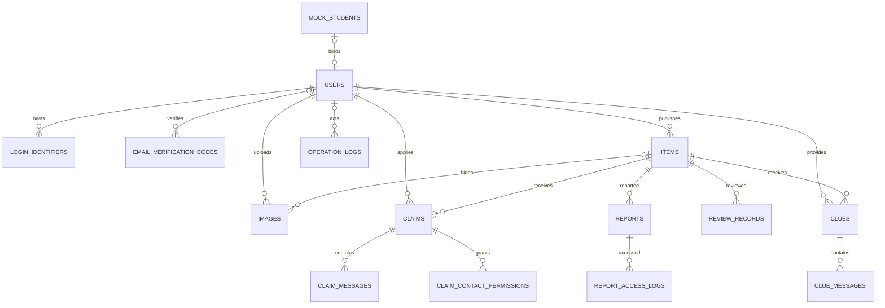

# 校园失物招领系统数据库设计

版本：0.1.0-draft。目标环境：本机 MySQL 8.0.34、Java 21、MyBatis。与接口合同 0.1.0-draft 配套。

前端已经确认 Vue 3、TypeScript、Vite、Vue Router、Pinia、Element Plus、Axios 和原生 CSS。本文件把接口中的物品、认领、线索和授权规则落实到关系模型；不代表应用已经开发完成，也不自动在现有 MySQL 服务建库。

## 文件和执行范围

| 文件 | 作用 |
| --- | --- |
| [建库脚本](../database/000_create_database.sql) | 创建项目库，不删除现有库；尚未对现有服务执行 |
| [核心迁移](../database/migrations/V001__core_schema.sql) | 13 张核心表、索引、CHECK、外键 |
| [选做举报迁移](../database/migrations/V002__optional_reports.sql) | 2 张举报与访问审计表 |
| [虚拟名册](../database/seeds/S001__mock_students.sql) | 5 条虚拟学生身份，不是已注册账号 |
| [字段字典](数据库字段字典.md) | 从隔离 MySQL 执行结果提取的完整字段、索引和外键 |
| [数据库使用说明](../database/README.md) | 初始化顺序、维护和验证方式 |
| [验证结果](数据库设计验证结果.json) | 实际隔离验证的结果及范围 |

总计 15 张表，其中举报相关 2 张为选做。没有增加自动匹配、实时聊天、通知中心、图片识别或统计报表。

## 表划分和维护责任

| 模块 | 表 | 用途 | 建议主维护者 |
| --- | --- | --- | --- |
| 身份 | mock_students | 虚拟名册，核对学号、姓名、校园卡 | 甲 |
| 身份 | users | 账号、密码哈希、私有联系方式、版本 | 甲 |
| 身份 | login_identifiers | 学号/卡号/管理员账号统一判重 | 甲 |
| 身份 | email_verification_codes | 验证码作用域、有效期、消费状态 | 甲 |
| 发布 | items | 寻物和招领内容、审核状态、选中申请 | 乙；丙通过业务服务调用状态变更 |
| 发布 | images | 临时上传、物品绑定、图片槽位 | 乙 |
| 认领 | claims | 申请、确认、拒绝、完成、关闭 | 丙 |
| 认领 | claim_messages | 认领双方的私有留言 | 丙 |
| 认领 | claim_contact_permissions | 本次认领中的个人授权开关 | 丙；甲修改资料时协同撤回 |
| 线索 | clues | 简化文字线索 | 乙 |
| 线索 | clue_messages | 线索双方私有留言 | 乙 |
| 管理 | review_records | 每次审核通过、退回、违规下架历史 | 丙 |
| 公共 | operation_logs | 关键状态和授权变更审计 | 三人调用公共写入能力 |
| 举报选做 | reports | 举报上下文和处理结论 | 丙 |
| 举报选做 | report_access_logs | 管理员读取私有会话的依据 | 丙 |

主维护者负责表结构演进；不代表该表只能由一个人的业务使用。所有跨模块写入遵循共同服务方法和事务，不由三个模块分别复制一套 SQL 规则。

## 主要关系



图为主关系概览；所有约束以 SQL 与字段字典为准。items.accepted_claim_id 指向本物品的一条 claims；通过复合外键防止选择另一物品的申请。图片、认领、线索分别用复合外键约束其发布人归属。举报可绑定认领或线索之一，也可不绑定会话。

## 字段与类型原则

- 主键、外键和版本使用 BIGINT，与 Java Long 对齐；API 的 ID 转成正整数字符串，前端不当作 Number。
- 表名和字段 snake_case，DTO 使用 camelCase；启用 MyBatis 对应映射或显式 resultMap。
- 全库 InnoDB、utf8mb4、utf8mb4_0900_ai_ci。状态、登录标识、存储键等使用 ascii_bin，防止大小写宽松匹配；邮箱为 ASCII 并不区分大小写，服务统一 trim 与小写规范化。
- 时间使用 DATETIME(6)，统一 UTC 写入和读取；连接会话 time_zone=+00:00。occurred_date 是北京时间业务日期，不能把它当 UTC 时间戳转换。
- 状态使用 VARCHAR 加 CHECK，便于查询与演进。展示中文由前端状态字典映射，不在表中混存中英文。
- 布尔值使用 TINYINT 且 CHECK 限定 0/1。文本用 VARCHAR 并校验 CHAR_LENGTH，以 Unicode 码点对应接口计数。
- version 从 1 开始，服务每次有效变更递增；授权行不存在时接口返回 version=0，首次 INSERT 生成 version=1。updated_at 不能替代版本检查。
- 所有外键 RESTRICT，不通过级联删除清空历史。第一版无账号注销、物品硬删除、申请删除或留言撤回功能；临时未绑定文件清理由专门任务处理。
- 项目不通过触发器隐藏业务流程，状态联动在 Java 服务事务中明确实现。

## 接口字段到数据库的关键映射

| API 字段或对象 | 数据来源 | 注意事项 |
| --- | --- | --- |
| Me.studentId / realName / campusCardNo | users 连接 mock_students 的 student_no / real_name / campus_card_no | 管理员没有绑定，三个字段为 null |
| Item.publisher | items.publisher_id 连接 users.id / nickname | 不序列化整行 users，防止夹带私有信息 |
| Item.imageIds 输入 / images 输出 | images.item_id、position；关联时接收图片 ID，输出按 position 排序 | url 由受控图片接口生成，不直接返回磁盘 storage_key |
| hasConfirmedClaim | accepted_claim_id 对应 claims.status 是否为 CONFIRMED | 不能只凭指针存在判断有效 |
| Claim.applicant / publisher | claims 的两种用户角色连接 users | 列表不返回手机号、邮箱 |
| Clue.provider / publisher | clues 的两种角色连接 users | 仅关联双方可查 |
| ContactPermission.effective | 认领和物品当前状态计算 | 没有独立的、可能过期的数据库 effective 列 |
| ContactPermission.version | claim_contact_permissions.version | 无行返回 0；首次写入 1 |
| CounterpartyContact.phone / email | users 当前资料，加授权和状态过滤 | 未授权字段从 DTO 省略，不能直接返回 SQL 中的 null 占位 |
| expectedVersion | 与目标表 version 比较 | 请求条件，不另存一列；成功后原子递增 |
| requestId | 请求上下文，可写审计 request_id | 普通业务表不重复保存每次读取请求 |

## 身份数据为什么拆成三张表

mock_students 只存虚拟身份，users.student_record_id 唯一绑定该记录。学生资料中的 studentId、realName、campusCardNo 由 JOIN 名册得到，避免在两张表分别修改同一身份。名册绑定后不允许经业务接口改写。

管理员没有学生身份，student_record_id 为空；相应 Me 响应中的三个身份字段允许 null。此处已同步修正接口模型，避免数据库正确但登录响应不符合合同。

只给学号和卡号分别加 UNIQUE，不能阻止“甲的学号等于乙的卡号”。login_identifiers 使用 identifier 主键统一占用登录名：注册事务写入用户及两个去重后的标识；任意标识冲突则整个注册回滚。管理员预置账号也占用同一空间。同一个学生的学号和卡号恰好相同，只插入一行标识。

服务必须检查标识确实来自绑定名册，数据库唯一键只保证不冲突，不替代身份验证。

## 验证码与登录会话

email_verification_codes 按 purpose + email + subject_key 唯一。注册 user_id 为空、生成 subject_key=0；修改邮箱绑定用户 ID。生成列避免 MySQL 唯一键允许多条 NULL 导致同作用域多条验证码。

存储验证码的 HMAC-SHA256，密钥位于本地安全配置而非库中；HMAC 输入包含验证码、用途、用户作用域、邮箱及发送时间，避免跨用途复用。普通 SHA 摘要不足以抵御对六位验证码的离线枚举。重发覆盖旧记录、清空消费状态与错误次数；按作用域加锁后检查发送间隔。

注册/修改邮箱的事务同时校验有效期、HMAC、未消费状态，并完成业务写入和 consumed_at 更新；验证码正确但业务失败时不应留下半个账号。注册用途和修改邮箱用途不能混用。按来源的额外限流放在单实例服务的受控限流器，后续根据实际测试调整。

第一版 Session 和 CSRF 使用单后端进程的会话存储，不另建业务 session 表。users.auth_version 在改密时递增；会话保存登录时版本，每次私有请求比较，版本变化即拒绝旧会话。重启后要求重新登录是允许的；如将来多实例或要求重启保留登录，再单独设计共享会话。

## 数据库约束与服务规则的边界

| 规则 | 数据库保障 | Java 服务仍须执行 |
| --- | --- | --- |
| 身份唯一、登录标识不冲突 | UNIQUE、主键、外键 | 名册匹配、验证码、角色控制 |
| 同用户同物品不重复申请/线索 | 复合 UNIQUE | 类型、状态、身份与错误码转换 |
| 不给自己提交 | applicant/provider 与 publisher 的 CHECK；归属复合外键 | 从会话取用户，不能信任客户端身份 |
| 仅一人被确认 | winner_item_id 生成列 UNIQUE | 锁物品、关闭其他申请、更新 accepted_claim_id |
| 最多三张自己的图片 | 槽位 1～3 CHECK + UNIQUE(item_id,position) + 归属外键 | 检测真实文件、权限、临时文件处理 |
| 验证码作用域唯一 | 生成列唯一键 | 重发、有效期、频率、HMAC、一次性消费 |
| 授权只给认领另一方 | 主键唯一、合法开关、有效用户/申请外键 | 参与者关系、CONFIRMED、物品有效、字段存在 |
| 交接后授权失效 | 事务可原子写入 | 完成流程主动清空；读取必须重新检查状态 |
| 举报上下文合法 | 认领/线索互斥、同物品复合外键 | 举报者为参与人、管理员角色和待处理状态 |
| 留言只有双方可读写 | 对象外键、长度约束 | 双方关系、终态只读、文字内容限制 |

MySQL CHECK 不能承担依赖其他行、当前时间、当前登录用户的全部规则。查询的权限条件仍是实现的一部分。当前版本支持生效的 CHECK；唯一索引允许多个 NULL 是单一获选生成列的基础。[CHECK 约束](https://dev.mysql.com/doc/refman/8.0/en/create-table-check-constraints.html)、[唯一索引与外键](https://dev.mysql.com/doc/refman/8.0/en/create-table.html)

## 单一认领人的两层保障

claims.winner_item_id 是只读生成列：status 为 CONFIRMED 或 COMPLETED 时等于 item_id，否则为 NULL。UNIQUE(winner_item_id) 使同一物品不能同时有两个确认/完成记录；多条待确认申请可以共存。

业务事务仍需锁 items 主行，检查 PUBLISHED、FOUND、未占用和 expectedVersion，再确认目标申请、写 accepted_claim_id、关闭其他 PENDING 申请并记录审计。数据库唯一键是最后防线，不代替完整状态转换。

accepted_claim_id 保留获选历史，违规下架后不凭“这个指针非空”判断仍可认领或仍有授权。hasConfirmedClaim 从关联申请当前状态计算。

## 联系方式与交接事务

claim_contact_permissions 只存开关，不复制手机号、邮箱，不存任意 recipient_id。另一方由 claims 的 publisher_id/applicant_id 推导。

交接完成事务步骤：

1. 识别本人及认领双方，按用户 ID 升序锁定需要协调的用户行。
2. 锁物品，再锁申请；校验发布人、CONFIRMED、物品 PUBLISHED、accepted_claim_id 和 expectedVersion。
3. 申请改 COMPLETED；物品改 ARCHIVED，closure_reason=HANDOVER，写完成时间与版本。
4. 清空双方授权开关，递增已有授权版本；不存在的授权行无需人为创建。
5. 同事务写 operation_logs，最后提交；任何一步失败全部回滚。

涉及联系方式的操作采用相同锁顺序：用户行（ID 升序）→物品→认领→授权行。修改自己的联系方式先锁自己的用户行，再修改资料及撤回该字段所有授权，不反向再去拿物品锁。批量影响多物品时按 ID 排序，并在锁后重验关系；对 MySQL 死锁/锁等待失败，回滚后执行有上限的整体重试，不能部分继续。

授权查询必须同时检查请求者为参与者、对方身份、CONFIRMED、PUBLISHED、开关和当前资料。为保证完成提交后的查询无数据，使用新的短事务和锁定读，不复用旧长事务快照。返回时仅构建获准字段的 DTO；未授权字段省略。示意查询（参数由服务绑定，不直接拼接）：

```sql
SELECT p.phone_visible, p.email_visible,
       CASE WHEN p.phone_visible=1 THEN u.phone ELSE NULL END AS phone,
       CASE WHEN p.email_visible=1 THEN u.email ELSE NULL END AS email
FROM claims c
JOIN items i ON i.id=c.item_id
JOIN claim_contact_permissions p ON p.claim_id=c.id
JOIN users u ON u.id=p.grantor_id
WHERE c.id = :claimId
  AND :currentUserId IN (c.publisher_id,c.applicant_id)
  AND p.grantor_id = CASE WHEN :currentUserId=c.publisher_id
                         THEN c.applicant_id ELSE c.publisher_id END
  AND c.status='CONFIRMED' AND i.status='PUBLISHED'
  AND ((p.phone_visible=1 AND u.phone IS NOT NULL) OR p.email_visible=1);
```

该 SELECT 用于说明过滤条件，不是完整事务实现；服务先按上述顺序加锁、判定 404/409/403，再查询。完成前已发出的资料不能追回，接口禁止缓存。修改手机号/邮箱时撤回对应字段授权，防止静默暴露新资料。

## 图片绑定与文件一致性

images 每张一行，item_id 与 position 同时为空表示临时上传；绑定时 position 为 1、2、3，唯一键保障不会出现第四张。复合外键 (item_id,uploader_id) 引用 (items.id,publisher_id)，保证图片属于发布人。

编辑时先在事务中锁定本人物品及所有相关图片，验证图片属于本人且未绑定其他物品。清空本物品旧槽位，再按提交顺序重新绑定，避免直接交换 1、2 槽位触发唯一冲突；更新物品与关系一起提交。解除关联的图片回到仅上传者可读的临时状态。

文件系统与数据库不是同一事务。上传先写临时文件，再保存数据库元数据；失败清理临时文件。定时清理过期未绑定图片时，要加锁重验仍未绑定；文件缺失需返回可处理错误，不伪造上传成功。文件存储键由服务产生，不能接收客户端路径。

## 索引与查询设计

| 查询 | 主要索引 | 说明 |
| --- | --- | --- |
| 公共时间列表 | items(status,published_at DESC,id DESC) | 只查 PUBLISHED，稳定排序 |
| 类型类别日期筛选 | items(status,type,category,occurred_date,id) | 组合筛选基础索引，不保证所有条件组合都最优 |
| 我的发布 | items(publisher_id,created_at DESC,id DESC) | 归属过滤必须在 SQL 中 |
| 待审核列表 | items(status,created_at,id) | 审核顺序 |
| 我的/收到的申请 | claims(applicant_id/ publisher_id,created_at DESC,id DESC) | 两个索引分别支持两种角色 |
| 同物品待处理申请 | claims(item_id,status,id) | 确认后关闭其他申请 |
| 我的/收到的线索 | clues(provider_id/ publisher_id,created_at DESC,id DESC) | 两个角色索引 |
| 会话留言 | claim_messages(claim_id,created_at,id)，线索同理 | 顺序分页 |
| 修改资料后撤回授权 | claim_contact_permissions(grantor_id,claim_id) | 找到该用户所有相关授权 |
| 待处理举报 | reports(status,created_at,id) | 选做 |

标题/描述包含搜索和地点包含匹配的 `%关键词%` 不能指望普通 B-tree 解决。第一版维持合同的包含语义，配合状态与筛选减少候选集，用真实 1 万条测试数据检查 EXPLAIN 与耗时；不能以添加一个索引就宣称满足 100 并发指标。暂不引入 Elasticsearch，也不把 FULLTEXT 的分词搜索悄悄替换成原定包含语义。

## 状态、留痕和选做举报

物品、认领状态以及终态留言规则沿用接口 BR-04～BR-08。状态变化同步 operation_logs；审核还追加 review_records，不能用最新原因覆盖全部历史。通用审计的 entity_id 是多态引用，无数据库外键，由服务保证对象合法；日志不复制密码、验证码、联系方式和留言正文。

reports 的 claim_id、clue_id 最多一个，同物品关联有真实外键。管理员只能通过待处理举报读相关会话，每次追加 report_access_logs；普通管理员身份不能绕过该路径。TAKE_DOWN 或 REJECT_PENDING_CLAIM 的业务效果与举报处理结论同事务提交。

## 验证与后续开发边界

隔离验证使用已安装的 MySQL 二进制、全新 TEMP 数据目录、仅本机随机端口，结束关闭自己的进程，不修改原有服务或现有数据。校验实际迁移、约束拒绝、交接回滚、状态过滤及两连接并发 SQL 样例；具体结果以验证 JSON 为准。

这不等同于后端业务验收：数据库不能直接判断当前用户权限、真实图片内容、邮件送达或验证码 HMAC 正确性，尚需 Java 服务测试。原接口验收计划保持“未执行”。未做负载测试，不声称性能指标已达成。

待实际建工程时再创建应用账号、配置本地数据库凭据、生成管理员真实密码哈希、初始化可登录演示用户。学校身份格式与邮件演示方式仍按接口 P-01 确认；本轮不向用户真实数据库写入任何内容。
